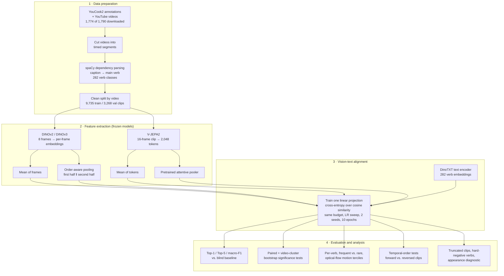

# Vision-Text Feature Alignment for Action Recognition

**Does a video model that understands motion recognize actions better than an image model that only sees still frames?**

This project compares a self-supervised **video** model (Meta's **V-JEPA2**) against self-supervised **image** models (**DINOv2 / DINOv3**) on recognizing cooking actions such as *pour*, *stir*, *cut* and *remove* in the **YouCook2** dataset. Every model's features are aligned to a shared text space (**DinoTXT**), so each clip is classified by finding the verb whose text embedding it is closest to.

Built during the Algoverse AI Research Program (June–December 2025). **Status: ongoing.** The core experiments are complete and their results are saved in [`processed/`](processed/); follow-up experiments are in progress.

---

## Key results

All numbers are on the **3,268 validation clips** (450 videos never seen in training), 282 verb classes.

| Model | How the clip is summarized | Top-1 accuracy | Macro-F1 |
|---|---|---|---|
| Blind baseline (always guesses "add") | no video at all | 35.65% | 0.32% |
| DINOv2 + DinoTXT (image) | average of 8 frames | 42.96% | 5.37% |
| DINOv3 + DinoTXT (image) | average of 8 frames | 43.01% | n/a¹ |
| V-JEPA2 + DinoTXT (video) | simple average of tokens | 38.79% | 1.20% |
| **V-JEPA2 + DinoTXT (video)** | **pretrained attentive pooler** | **43.62%** | **5.39%** |
| DINOv2 + DinoTXT (image), order-aware | first-half + second-half averages | 43.18% | 5.32% |

Top-1 is the mean over 2 seeds; macro-F1 is from the representative checkpoint. ¹ DINOv3 macro-F1 is missing because its weights were not available when it was recomputed.

**What the results show**

1. **Pooling matters more than expected.** Replacing a simple average of V-JEPA2's 2,048 tokens with its pretrained attentive pooler (a small module that weights the important parts of the clip) raised Top-1 accuracy from 38.8% to 43.6% on the same model: **+4.6 points, 95% CI [+3.4, +5.7], p < 0.001** (paired bootstrap).
2. **On overall classification, video and image models tie.** V-JEPA2 vs. DINOv2: +0.8 points, 95% CI [−0.4, +2.0], p = 0.21. Macro-F1 is 5.39% vs. 5.37%.
3. **The video model encodes the direction of an action.** Shown a clip and the same clip reversed, a linear probe on V-JEPA2 features tells them apart **70.2%** of the time (chance is 50%). Frame-averaged DINOv2 scores exactly **50%**, because an average ignores order. Reversing an "add" clip moves V-JEPA2's prediction toward "remove" in **75%** of clips.
4. **A fair image baseline closes most of that gap.** When DINOv2 keeps the order of its frames (separate first-half and second-half averages), it reaches **72.5%** on the same forward/reversed test.
5. **The long tail is the hardest problem.** V-JEPA2 reaches 51.2% Top-1 on verbs with ≥50 training examples but **0.6%** on verbs with <10.
6. **YouCook2 is largely solvable from appearance.** A text-only model that reads the caption with the verb hidden scores 58.0%, above every video model, and a single DINOv2 frame (41.9%) almost matches the full clip (42.9%).

Every number above is read from a CSV in [`processed/`](processed/); see [Where each result lives](#where-each-result-lives).

---

## Engineering workflow



**Design choices**

- **Frozen backbones, one trainable layer.** Only a single linear projection is trained, with the same trainable-parameter budget, learning-rate sweep, seeds and epoch-selection rule for every model. That isolates the quality of each model's representation.
- **Split by video, not by clip.** No clip from a training video ever appears in validation (verified: 0 shared video IDs).
- **Macro-F1 next to Top-1.** One verb ("add") is 35.65% of the validation set, so Top-1 alone rewards guessing it. Macro-F1 weights all 282 verbs equally.
- **Bootstrap significance tests.** Gaps between models are re-measured on 10,000 resampled test sets, resampling whole videos where clips from the same video could be correlated.

---

## Models

| Model | Type | Role |
|---|---|---|
| [V-JEPA2](https://github.com/facebookresearch/vjepa2) ViT-L (`vjepa2-vitl-fpc16-256-ssv2`, `vjepa2-vitl-fpc64-256`) | Self-supervised video encoder | Video features, loaded through Hugging Face `transformers` |
| [DINOv2](https://github.com/facebookresearch/dinov2) ViT-L/14 + DinoTXT | Self-supervised image encoder + text encoder | Image features, and the text embeddings for all 282 verbs |
| [DINOv3](https://github.com/facebookresearch/dinov3) ViT-L/16 + DinoTXT | Self-supervised image encoder + text encoder | Second image baseline |

**Stack:** Python 3.12, PyTorch, Hugging Face `transformers`, spaCy, scikit-learn, OpenCV (Farneback optical flow), decord, pandas, NumPy. Full pinned environment: [`requirements.txt`](requirements.txt).

## Dataset

[YouCook2](http://youcook2.eecs.umich.edu/): YouTube cooking videos with timed step annotations and captions. After download (1,774 of 1,790 videos still available) and cleaning: **13,003 clips** (9,735 train / 3,268 validation) across **282 verb labels**, extracted from the captions. Videos and embeddings are not included in this repository because of their size (see [`.gitignore`](.gitignore)).

---

## Repository layout

```
annotations/          YouCook2 annotations, cleaned segment tables, verb labels, data-quality reports
notebooks_ordered/    The pipeline, numbered 01–36 in run order (start here)
  README.md           Run order and time estimates
  REPRODUCE.md        Full method notes, every phase and caveat (most up-to-date copy)
notebooks/            Original working notebooks and scripts (older numbering, kept for provenance)
  scripts/not_required/   Proof-of-concept and abandoned experiments, with a README on each
processed/            All saved results (CSV), one file per table
paths.json            Where the pipeline looks for videos, embeddings and checkpoints
requirements.txt      Pinned Python environment
```

## Reproducing

1. Create a Python 3.12 environment and `pip install -r requirements.txt`.
2. Edit [`paths.json`](paths.json) to point at your local folders for videos, embeddings, checkpoints, annotations, processed results and model repos.
3. Run [`notebooks_ordered/`](notebooks_ordered/) in numeric order. Notebooks 01–06 run top to bottom; scripts 07 onward run as `python3 <script>.py`. Several steps read files written by earlier ones, so order matters.

The full pipeline takes roughly **22–24 GPU-hours** (one A10). Two steps dominate: training the matched baselines (step 07, ~11–12h) and extracting V-JEPA2 embeddings from the label-free checkpoint (step 10, ~10h). To see results without a GPU, run `python3 notebooks_ordered/20_print_all_results.py`, which only reads the saved CSVs.

[`notebooks_ordered/REPRODUCE.md`](notebooks_ordered/REPRODUCE.md) documents every step: what it reads and writes, how long it takes, and why each design decision was made.

---

## Where each result lives

| Result | File in `processed/` | Script |
|---|---|---|
| Main comparison (Top-1, Top-5) | `nb8_final_summary.csv`, `nb8_vjepa2_pretrainedpool_seed_aggregate.csv`, `nb8_dinov2halves_seed_aggregate.csv` | 07, 13, 27 |
| Macro-F1 and blind baseline | `nb8_macro_f1_recomputed.csv` | 21 |
| Bootstrap significance tests | `nb8_paired_bootstrap.csv`, `nb8_paired_bootstrap_vjepa2_pretrainedpool.csv` | 07, 13 |
| Frequent vs. rare verbs | `nb8_frequent_vs_rare_vjepa2_pretrainedpool.csv` | 13 |
| Motion level (optical flow) | `nb8_optical_flow_tercile_vjepa2_pretrainedpool.csv`, `nb8_vjepa2_advantage_by_optical_flow.csv` | 09, 13 |
| Forward vs. reversed probe | `nb8_temporal_order_probe_split_level.csv`, `nb8_temporal_order_dinov2_perframe_probe.csv` | 16, 25 |
| "add" ↔ "remove" reversal shift | `nb8_temporal_order_antonym_summary.csv` | 18 |
| Truncated clips | `nb8_truncated_clip_comparison.csv` | 29–31 |
| Hard-negative verb pairs | `nb8_hard_negative_summary.csv`, `nb8_hard_negative_diffs.csv` | 34 |
| Appearance diagnostic | `nb8_appearance_diagnostic_overall.csv` | 36 |

---

## Limitations and open work

- **Labels come from captions.** Verbs are extracted automatically with spaCy, and the manual spot-check of extraction accuracy has not been reviewed yet.
- **Two seeds per model.** A 5-seed rerun was skipped because the comparison it would sharpen (macro-F1 5.37% vs. 5.39%) is already indistinguishable.
- **DINOv3 is incomplete.** Its macro-F1 and its rows in the later experiments are missing until its weights are restored.
- **The attentive-probe experiment (script 35) is inconclusive.** It failed its own check (shuffling frame order did not change its output), so it says nothing yet about token-level probes.
- **The headline V-JEPA2 pooler was trained on Something-Something v2 labels.** The encoder itself is self-supervised, and a fully label-free V-JEPA2 variant is reported alongside it (39.2% Top-1).
- **Partly complete side experiments** (per-timestep pooling head, video adapter) are documented in [`notebooks/scripts/not_required/README.md`](notebooks/scripts/not_required/README.md).

## Acknowledgements

Developed in the Algoverse AI Research Program with a project teammate and mentor. Uses V-JEPA2, DINOv2, DINOv3 and DinoTXT from Meta AI, and the YouCook2 dataset from the University of Michigan.
